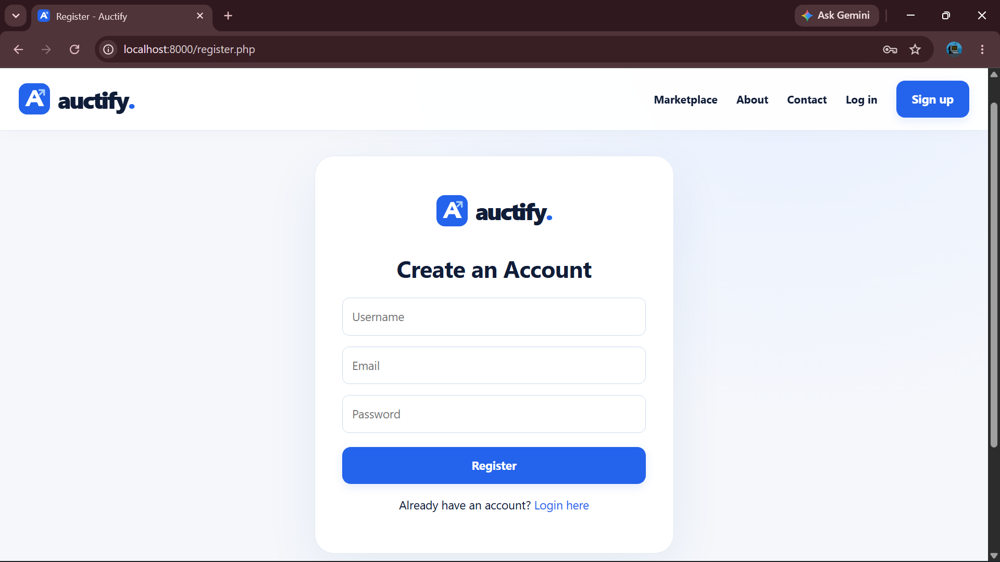
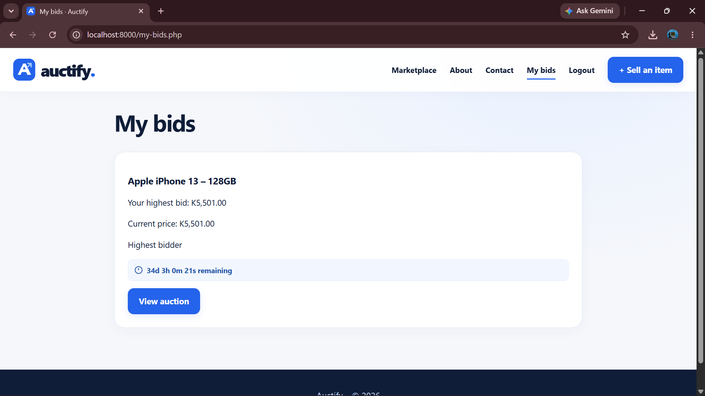

<div align="center">

# AUCTIFY

### Discover. Bid. Win.

A modern online auction marketplace designed for Zambia.


</div>

---

## Overview

Auctify is a full-stack online auction marketplace that connects buyers and sellers through competitive bidding.

The platform combines a modern animated interface with PHP backend functionality and MySQL database management to deliver an intuitive auction experience.

Built with the Zambian market in mind, Auctify uses Zambian Kwacha (ZMW) as its default currency.

## Screenshots

### Homepage


### Auction Details


### Login and Registration




### Create an Auction


### My Bids Dashboard



---

## Features

### Marketplace

- Browse active auctions
- Search available listings
- Competitive bidding
- Live auction countdowns
- Product image uploads
- Automatic rejection of expired bids
- Zambian Kwacha pricing

### User Accounts

- User registration
- User authentication
- Personal bidding dashboard
- Auction creation
- Bid management

### User Interface

- Custom Auctify branding
- Animated page transitions and entrance effects
- Interactive hover effects
- Animated auction cards
- Responsive layouts
- Mobile-friendly interface
- Custom typography and colour palette

---

## Technology Stack

| Technology | Purpose |
|---|---|
| HTML5 | Website structure |
| CSS3 | Styling and animations |
| JavaScript | Client-side interactions |
| PHP | Backend application logic |
| MySQL | Database management |
| Git | Version control |
| GitHub | Source code management |
| XAMPP | Local development environment |

## Brand Identity

| Colour | HEX |
|---|---|
| Midnight Blue | `#081C3B` |
| Royal Blue | `#2563EB` |
| Sky Blue | `#60A5FA` |
| Ice Blue | `#EFF6FF` |
| White | `#FFFFFF` |

The visual identity reflects trust, simplicity and modern digital commerce.

---

## Getting Started

### Prerequisites

- PHP 8.2 or compatible version
- MySQL Server
- MySQL Workbench or phpMyAdmin
- Git

### 1. Clone the repository

```bash
git clone https://github.com/nancymunkombwe/auction-system.git
cd auction-system
```

### 2. Configure the database

Create a MySQL database named:

```sql
CREATE DATABASE IF NOT EXISTS auction_system;
```

Import or create the required database tables.

### 3. Configure the database connection

Create or configure `includes/db.php` using your local database credentials.

| Setting | Local configuration |
|---|---|
| Host | localhost |
| Database | auction_system |
| Port | 3307 |
| Username | Your MySQL username |
| Password | Your MySQL password |

The port may differ depending on your MySQL installation.

Never commit real database credentials to version control.

### 4. Start the application

```bash
php -S localhost:8000
```

Alternatively, for Windows users with XAMPP:

```powershell
C:\xampp\php\php.exe -S localhost:8000
```

### 5. Open the website

Visit:

http://localhost:8000

---

## Database Architecture

Auctify uses a relational MySQL database.

| Table | Purpose |
|---|---|
| users | Stores registered user accounts |
| auctions | Stores auction listings and pricing |
| bids | Stores user bidding records |

The database manages relationships between users, auctions and bids.

---

## Development Roadmap

- [x] Marketplace interface
- [x] User registration
- [x] User authentication
- [x] Auction creation
- [x] Bidding functionality
- [x] MySQL integration
- [x] Product image uploads
- [x] Custom brand identity
- [x] UI animations
- [x] Responsive design
- [ ] Real-time multi-user bidding
- [ ] Watchlist functionality
- [ ] Email notifications
- [ ] User verification
- [ ] Administrator dashboard
- [ ] Mobile money integration
- [ ] Automated payment processing
- [ ] Cloud deployment
- [ ] Production security testing

---

## Project Vision

Auctify aims to become a modern digital auction platform that simplifies buying and selling across Zambia.

Potential auction categories include:

- Vehicles
- Electronics
- Real estate
- Agricultural equipment
- Furniture
- Industrial equipment
- Business assets

---

## Project Status

Auctify is currently under active development.

The application is intended for local development and demonstration purposes. Production deployment and payment integrations are planned for future releases.

---

<div align="center">

## AUCTIFY

**Discover. Bid. Win.**

Designed and developed in Zambia.

Copyright © 2026 Auctify. All rights reserved.

</div>
