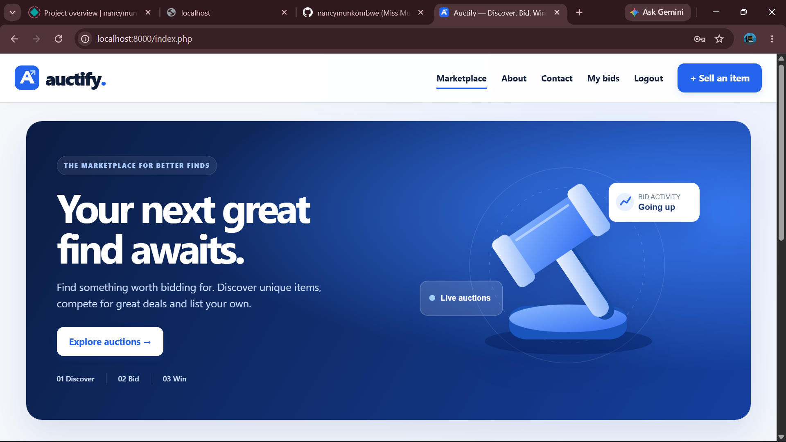
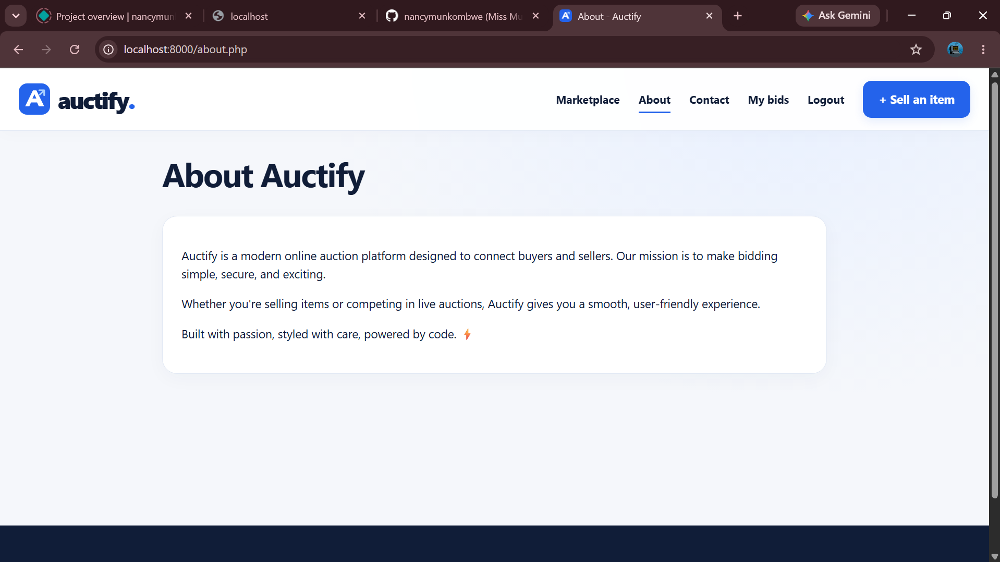
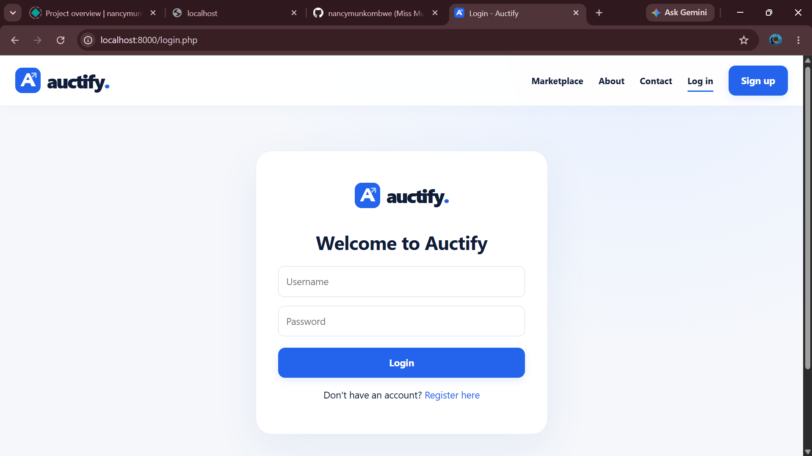
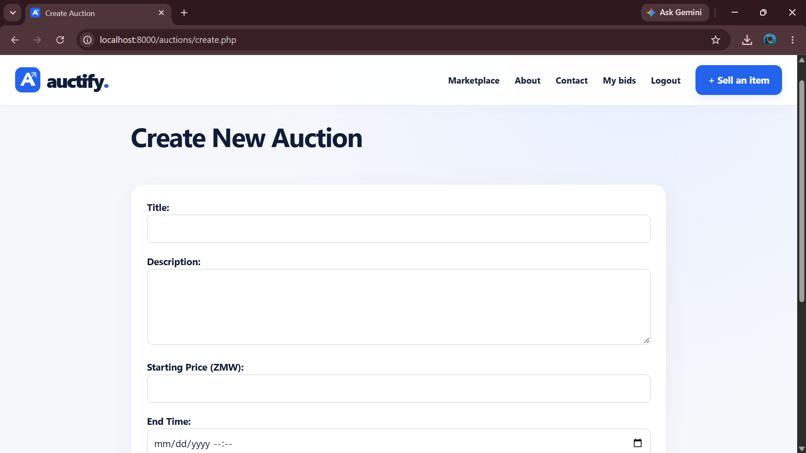
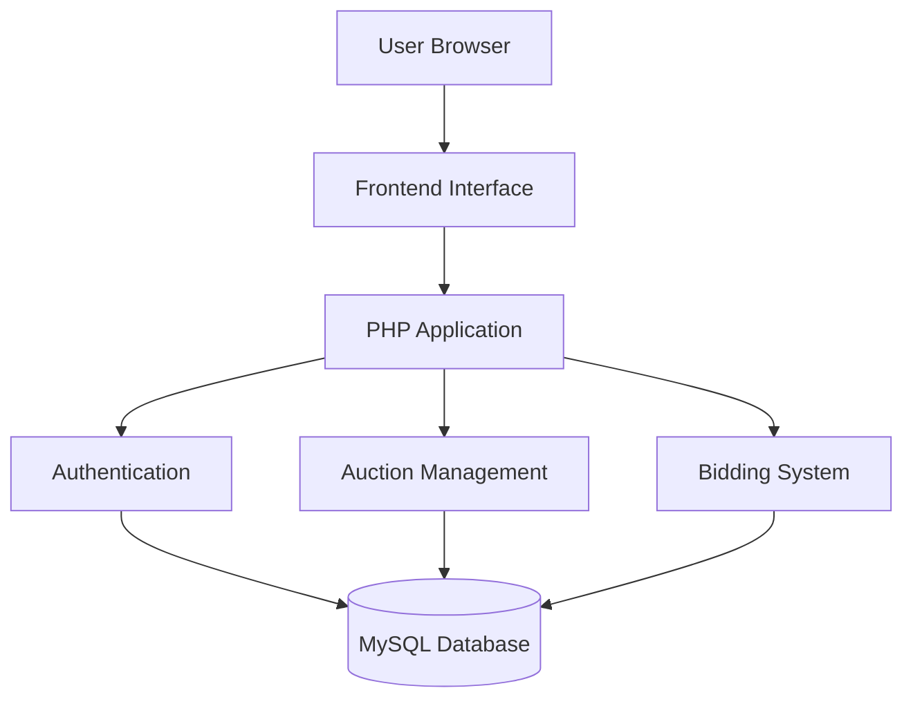
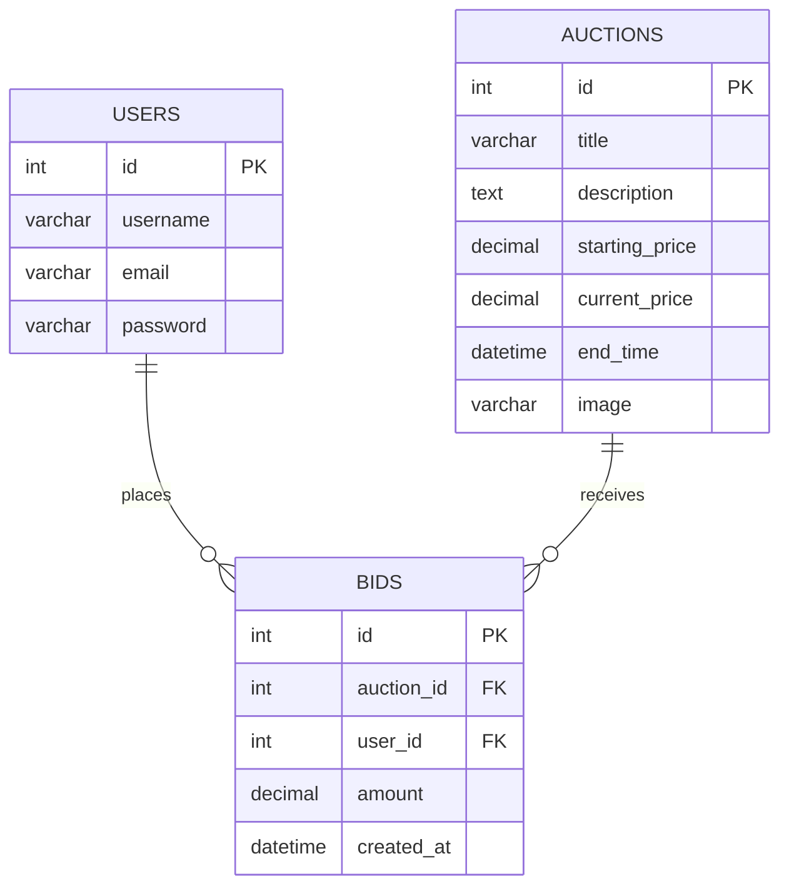

<div align="center">

# AUCTIFY

### Discover. Bid. Win.

A modern, full-stack online auction marketplace designed for Zambia.


[Overview](#overview) • [Screenshots](#screenshots) • [Features](#features) • [Installation](#installation) • [Roadmap](#roadmap)

</div>

---

## Overview

Auctify is a full-stack digital auction marketplace that connects buyers and sellers through competitive online bidding.

Developed with a focus on usability, functionality and modern design, Auctify combines a responsive, animated frontend with a PHP backend and a relational MySQL database.

The platform is designed with the Zambian market in mind, using Zambian Kwacha (ZMW) as its default currency.

---

## Screenshots

### Homepage

A modern marketplace interface for discovering and browsing available auctions.



### About Auctify

An introduction to the platform, its purpose and vision.



### User Authentication

| Login | Registration |
|---|---|
|  |  |

### Create an Auction

Users can publish auction listings, upload product images, set starting prices and specify auction deadlines.



### My Bids Dashboard

A dedicated dashboard for users to view their bidding activity.


---

## Features

### Auction Marketplace

- Browse available auctions
- Search auction listings
- Create and publish auctions
- Competitive bidding system
- Live auction countdown timers
- Product image uploads
- Automatic rejection of bids after auction expiry
- Zambian Kwacha (ZMW) pricing

### User Management

- User registration
- User authentication
- Password hashing
- Session-based authentication
- Personal bidding dashboard
- User logout functionality

### User Experience

- Custom Auctify branding and logo
- Modern blue colour palette
- Responsive website layout
- Smooth entrance animations
- Animated auction cards
- Interactive hover effects
- Mobile-friendly interface
- Custom browser favicon

### Backend and Database

- PHP server-side application logic
- MySQL relational database
- Server-side bid validation
- Auction expiry validation
- Transaction-based bidding
- Product image upload validation

---

## Technology Stack

| Technology | Purpose |
|---|---|
| HTML5 | Application structure |
| CSS3 | Styling, layouts and animations |
| JavaScript | Client-side interactions |
| PHP 8.2 | Backend application logic |
| MySQL | Relational database |
| MySQL Workbench | Database administration |
| XAMPP | Local PHP development |
| Git | Version control |
| GitHub | Source code management |
| Visual Studio Code | Development environment |

---

## Brand Identity

Auctify's visual identity is built around a modern blue colour palette, reflecting trust, professionalism and digital accessibility.

| Colour | HEX Code |
|---|---|
| Midnight Blue | `#081C3B` |
| Royal Blue | `#2563EB` |
| Sky Blue | `#60A5FA` |
| Ice Blue | `#EFF6FF` |
| White | `#FFFFFF` |

**Brand name:** Auctify

**Tagline:** Discover. Bid. Win.

---

## System Architecture



The application uses a client-server architecture, with PHP handling application logic and MySQL managing persistent data.

---

## Database Architecture

The application uses three primary relational database tables.

| Table | Description |
|---|---|
| `users` | Stores registered user accounts |
| `auctions` | Stores auction listings, prices and deadlines |
| `bids` | Stores individual bidding transactions |



---

## Installation

### Prerequisites

Ensure the following software is installed:

- PHP 8.2 or a compatible version
- MySQL Server
- MySQL Workbench or phpMyAdmin
- Git
- Visual Studio Code (optional)

### 1. Clone the repository

```bash
git clone https://github.com/nancymunkombwe/auction-system.git
cd auction-system
```

### 2. Create the database

Open MySQL Workbench and execute:

```sql
CREATE DATABASE IF NOT EXISTS auction_system;
USE auction_system;

CREATE TABLE IF NOT EXISTS users (
    id INT UNSIGNED AUTO_INCREMENT PRIMARY KEY,
    username VARCHAR(100) NOT NULL UNIQUE,
    email VARCHAR(254) NOT NULL UNIQUE,
    password VARCHAR(255) NOT NULL,
    created_at DATETIME DEFAULT CURRENT_TIMESTAMP
);

CREATE TABLE IF NOT EXISTS auctions (
    id INT UNSIGNED AUTO_INCREMENT PRIMARY KEY,
    title VARCHAR(255) NOT NULL,
    description TEXT NOT NULL,
    starting_price DECIMAL(15,2) NOT NULL,
    current_price DECIMAL(15,2) NOT NULL,
    end_time DATETIME NOT NULL,
    image VARCHAR(255),
    created_at DATETIME DEFAULT CURRENT_TIMESTAMP
);

CREATE TABLE IF NOT EXISTS bids (
    id INT UNSIGNED AUTO_INCREMENT PRIMARY KEY,
    auction_id INT UNSIGNED NOT NULL,
    user_id INT UNSIGNED NOT NULL,
    amount DECIMAL(15,2) NOT NULL,
    created_at DATETIME DEFAULT CURRENT_TIMESTAMP,
    FOREIGN KEY (auction_id) REFERENCES auctions(id),
    FOREIGN KEY (user_id) REFERENCES users(id)
);
```

### 3. Configure the database connection

Create or configure `includes/db.php` using your local MySQL credentials.

```php
<?php

date_default_timezone_set("Africa/Lusaka");

$servername = "localhost";
$username = "root";
$password = "YOUR_MYSQL_PASSWORD";
$dbname = "auction_system";
$port = 3307;

$conn = new mysqli(
    $servername,
    $username,
    $password,
    $dbname,
    $port
);

if ($conn->connect_error) {
    die("Database connection failed.");
}

$conn->set_charset("utf8mb4");
$conn->query("SET time_zone = '+02:00'");
```

Update the password and port according to your MySQL configuration.

**Security notice:** Never commit real database credentials to GitHub.

### 4. Start the application

Using PHP:

```bash
php -S localhost:8000
```

For Windows users running PHP through XAMPP:

```powershell
C:\xampp\php\php.exe -S localhost:8000
```

### 5. Access Auctify

Open the following address in your browser:

```
http://localhost:8000
```

Ensure your MySQL server is running before launching the application.

---

## How It Works

1. A user creates an account.
2. The user logs into the marketplace.
3. A seller creates an auction listing.
4. Buyers browse available auctions.
5. Buyers submit competitive bids.
6. The highest accepted bid updates the auction price.
7. The auction closes when its deadline is reached.

---

## Supported Auction Categories

Auctify is designed to accommodate a wide range of products and assets, including:

- Vehicles
- Electronics
- Real estate
- Agricultural equipment
- Furniture
- Industrial equipment
- Business assets
- Collectibles
- General merchandise

---

## Roadmap

### Phase 1 — Core Development

- [x] Marketplace interface
- [x] User registration and login
- [x] MySQL database integration
- [x] Auction creation
- [x] Bidding functionality
- [x] Product image uploads
- [x] Auction countdown timers
- [x] Personal bidding dashboard

### Phase 2 — Design and Branding

- [x] Custom Auctify logo
- [x] Blue visual identity
- [x] Animated user interface
- [x] Responsive design
- [x] Browser favicon
- [x] Project documentation

### Phase 3 — Platform Expansion

- [ ] Real-time bidding updates
- [ ] User profiles
- [ ] Watchlist functionality
- [ ] Auction categories and advanced filtering
- [ ] Email notifications
- [ ] Outbid notifications
- [ ] Seller ratings and reviews
- [ ] Reserve prices
- [ ] Administrator dashboard
- [ ] User identity verification

### Phase 4 — Commercial Deployment

- [ ] Cloud hosting
- [ ] Custom domain
- [ ] Mobile money integration
- [ ] Payment processing
- [ ] Automated auction settlements
- [ ] Fraud prevention
- [ ] Production security testing
- [ ] Public marketplace launch

---

## Project Vision

Auctify aims to modernise the auction experience in Zambia by creating an accessible digital marketplace for individuals, businesses and organisations.

The long-term vision is to support private sellers, vehicle dealerships, financial institutions, agricultural businesses and corporate asset auctions through a unified online platform.

---

## Project Status

Auctify is currently under active development.

The current release is intended for local development, demonstration and portfolio purposes. Cloud deployment, payment integrations and additional security testing are planned for future releases.

---

## Developer

**Nancy Munkombwe**

[GitHub Profile](https://github.com/nancymunkombwe)

---

<div align="center">

# AUCTIFY

**Discover. Bid. Win.**

Designed and developed in Zambia.

Copyright © 2026 Auctify. All rights reserved.

</div>
